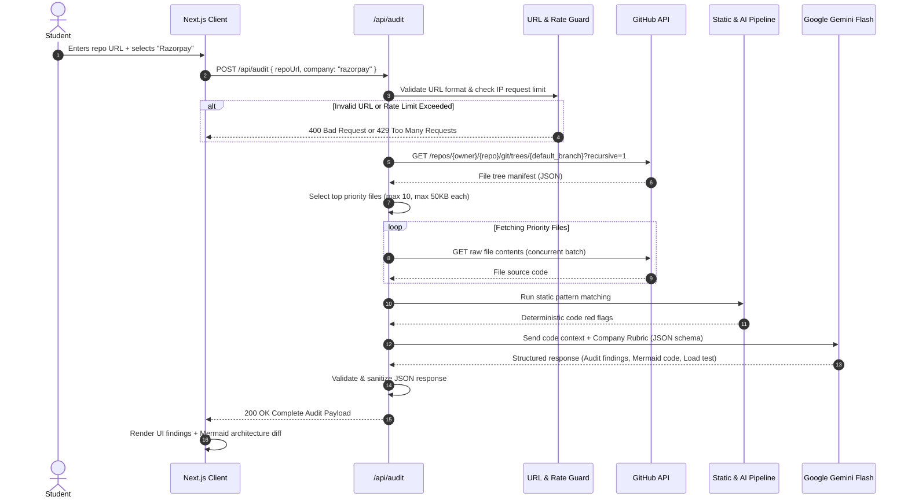
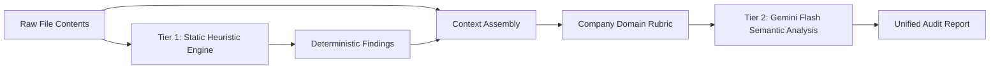
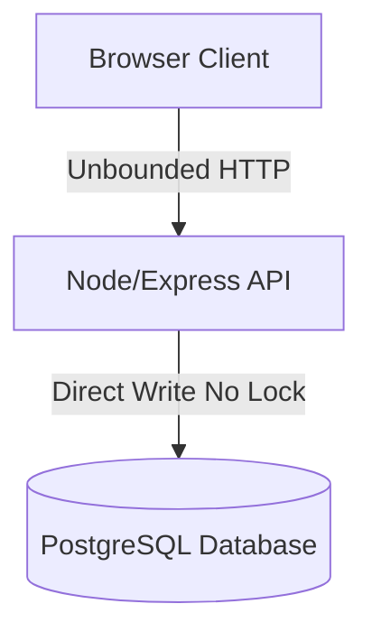
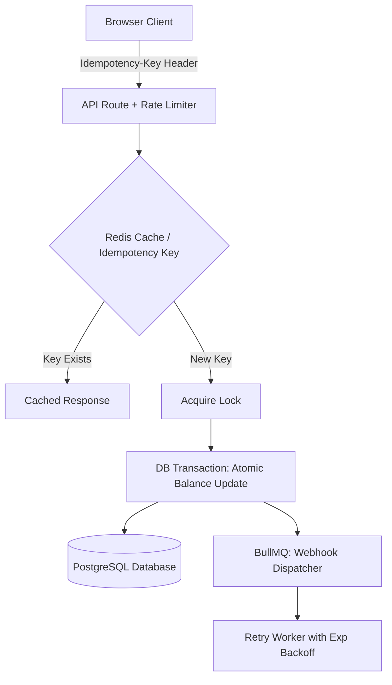

# RepoDoctor AI (StackFit AI) - System Architecture

## 1. Executive Summary & Engineering Objectives

**RepoDoctor AI** is a lightweight, zero-cost engineering intelligence platform designed for college students preparing for campus placements and technical interviews. It bridges the critical divide between "tutorial-clone code" and production-grade engineering standards demanded by target tech companies (such as Razorpay, Swiggy, Zerodha, and Amazon).

### Core Objectives
1. **Evidence-Grounded Auditing:** Parse observable repository source code via the GitHub REST API rather than guessing from conversational prompts.
2. **Deterministic & Semantic Synthesis:** Combine fast static heuristics (regex/AST parsing of dependencies and schemas) with semantic reasoning via Google Gemini Flash.
3. **Actionable Systems Engineering:** Produce concrete Before/After architecture diagrams in Mermaid.js and runnable edge-case test scripts (e.g., concurrency stress scripts).
4. **Pragmatic Simplicity (Ponytail Architecture):** Deliver a unified Next.js full-stack application deployable on Vercel's free tier without introducing premature infrastructure (no distributed Redis, external databases, or microservice bloat for the MVP).

---

## 2. High-Level Architecture

The application runs as a unified full-stack Next.js project on Vercel. All data flow is stateless per request during the MVP phase, utilizing client-side caching (LocalStorage/SessionStorage) and server-side in-memory deduplication.

```mermaid
flowchart TD
    subgraph Client["Client Tier (Next.js / Browser)"]
        UI["Web Dashboard UI"]
        Input["Repo URL & Target Company Selector"]
        Viewer["Audit Report & Evidence Viewer"]
        MermaidRenderer["Mermaid.js Diagram Renderer"]
        TestRunnerDoc["Test Script Inspector & Downloader"]
    end

    subgraph Server["Serverless Backend Tier (Next.js Route Handlers)"]
        APIRoute["/api/audit Endpoint"]
        RateLimiter["In-Memory Rate Limiter & URL Guard"]
        GHClient["GitHub REST API Adapter"]
        StaticScanner["Static Rule & File Classifier"]
        PromptBuilder["Prompt Builder & Domain Knowledge Context"]
        LLMClient["Gemini Flash Client (Structured JSON)"]
        Sanitizer["Schema Validator & Sanitizer"]
    end

    subgraph External["External Upstream Services"]
        GitHub["GitHub REST API (api.github.com)"]
        GeminiAPI["Google AI Studio (Gemini 2.0/1.5 Flash)"]
    end

    Input -->|POST { repoUrl, targetCompany }| APIRoute
    APIRoute --> RateLimiter
    RateLimiter --> GHClient
    GHClient -->|Fetch tree & key files| GitHub
    GitHub -->|Raw source files| GHClient
    GHClient --> StaticScanner
    StaticScanner --> PromptBuilder
    PromptBuilder --> LLMClient
    LLMClient -->|Generate audit & Mermaid diff| GeminiAPI
    GeminiAPI -->|Structured JSON| LLMClient
    LLMClient --> Sanitizer
    Sanitizer -->|Validated Audit Report| APIRoute
    APIRoute -->|200 OK JSON| Viewer
    Viewer --> MermaidRenderer
    Viewer --> TestRunnerDoc
```

---

## 3. Component Boundaries & Responsibilities

| Component | Layer | Primary Responsibility |
|---|---|---|
| **Audit Form & Selector** | Frontend | Validates public GitHub URL formatting; lets user choose target company; manages submission state. |
| **Audit Findings Dashboard** | Frontend | Displays prioritized issues (Critical, Warning, Optimization) linked to exact file citations. |
| **Mermaid Diagram Engine** | Frontend | Dynamically renders client-side interactive system diagrams (Current vs. Target Architecture). |
| **Script Sandbox Viewer** | Frontend | Displays syntax-highlighted runnable load-test scripts; offers 1-click copy and execution instructions. |
| **Audit Route Handler (`/api/audit`)** | Backend | Coordinates pipeline: validates input, enforces rate limits, orchestrates GitHub and Gemini calls. |
| **GitHub Ingestor (`lib/github.ts`)** | Backend | Calls GitHub Git Tree API recursively, filters candidate files, fetches raw contents with size bounds. |
| **Static Heuristic Engine (`lib/staticRules.ts`)** | Backend | Performs deterministic checks (e.g., float types in SQL/Prisma, missing DB indexes, plain text secrets). |
| **Gemini AI Client (`lib/gemini.ts`)** | Backend | Interacts with Gemini Flash using strict `responseSchema` JSON mode; validates output format. |
| **Domain Rubrics (`lib/companies/`)** | Backend | Curated company profiles (Fintech, Foodtech/Logistics, High-Throughput Trading, Big Tech). |

---

## 4. End-to-End Request Lifecycle



---

## 5. Repository Ingestion & File-Selection Strategy

Students often submit repositories containing hundreds of irrelevant files (e.g., build artifacts, images, lockfiles). The server implements an intelligent prioritization filter:

### Exclusion List
- Dependency directories: `node_modules/`, `vendor/`, `venv/`, `__pycache__/`, `.git/`
- Build output: `dist/`, `build/`, `.next/`, `out/`, `target/`
- Static media: `*.png`, `*.jpg`, `*.svg`, `*.ico`, `*.pdf`, `*.mp4`
- Lockfiles: `package-lock.json`, `yarn.lock`, `pnpm-lock.yaml`, `poetry.lock`

### Prioritized Scoring Heuristic
Files are scored based on architectural relevance:
1. **Manifests & Schemas (Score 100):** `package.json`, `schema.prisma`, `models.py`, `migrations/*.sql`
2. **Server & Entry Points (Score 90):** `server.ts`, `app.ts`, `index.js`, `main.py`, `routes/*`
3. **Controllers & Business Logic (Score 80):** `controllers/*`, `services/*`, `api/*`
4. **Configuration (Score 60):** `docker-compose.yml`, `Dockerfile`, `.env.example`

### Safety & Size Enforcements
- **Max Files Inspected:** 10 files per repository.
- **Max File Size:** 50 KB per file (truncated safely if larger).
- **Total Ingestion Token Cap:** Under 30,000 tokens per analysis to preserve Gemini free-tier limits.

---

## 6. Code Analysis Pipeline: Hybrid Deterministic + Semantic

To prevent hallucinations, the engine relies on a two-tier analysis model:



### Tier 1: Static Deterministic Rules (Ground Truth)
- Scans `package.json` for missing key packages (e.g., missing validation libraries like `zod` or `joi`, missing `helmet`, missing rate-limiters).
- Scans Prisma/SQL schemas for missing compound indexes, foreign key constraints, or floating-point usage for monetary values.
- Scans API routes for missing error-handling middleware (`try-catch` omission, unhandled promise rejections).

### Tier 2: Gemini Semantic Reasoning
- Assesses structural architectural design and code cleanliness.
- Evaluates whether the implementation satisfies the target company's domain paradigms (e.g., idempotency, queue retries, cache invalidation).
- Generates system design diagrams and interview defense questions.

---

## 7. Company & Domain-Specific Audit Rubrics

Audit rules are mapped to specific engineering domains:

### 1. Fintech & Payments (e.g., Razorpay, Cred, Stripe)
- **Primary Concern:** Data integrity, transaction atomicity, and financial consistency.
- **Rules:**
  - Float ban: Monetary amounts must be integers (cents/paise) or `Decimal`/`BigInt`.
  - Idempotency: Payment execution endpoints must require and enforce idempotency keys.
  - Webhook resilience: Webhook listeners must handle duplicate delivery and signature verification.
  - Distributed locks: Balance updates must be protected against race conditions.

### 2. Logistics & Hyper-Local Delivery (e.g., Swiggy, Zomato, Uber)
- **Primary Concern:** High concurrency, spatial tracking, low latency.
- **Rules:**
  - Caching & Geo-queries: Spatial lookups must leverage spatial indexes or Redis Geo.
  - Asynchronous dispatch: Heavy operations must be offloaded to background task queues.
  - Graceful degradation: Fallbacks for slow external service calls.

### 3. High-Throughput / Minimalist Systems (e.g., Zerodha)
- **Primary Concern:** Performance, minimal dependencies, database connection management.
- **Rules:**
  - Lean dependency footprint: Elimination of bloated packages where native primitives suffice.
  - Database pooling: Explicit connection pool boundaries to avoid connection exhaustion.

### 4. Scalable Cloud & Distributed Systems (e.g., Amazon, Microsoft)
- **Primary Concern:** Resilience, observability, security boundaries.
- **Rules:**
  - Structured logging: Avoid `console.log`; enforce contextual structured logs.
  - Circuit breaking & timeout configs on external network calls.
  - Secure credential injection and environment isolation.

---

## 8. Before/After Architecture Generation (Mermaid.js)

Instead of vague advice, the system generates valid Mermaid flowchart code comparing current vs. recommended architecture:

### Current Architecture Graph (Generated from inspected files)


### Recommended Target Architecture Graph


---

## 9. Test-Script Generation & Validation

To help students prove their engineering depth during technical interviews, RepoDoctor generates a runnable test script:
- **Format:** Standalone Node.js script using native `fetch` or a lightweight `k6` benchmark script.
- **Purpose:** Demonstrates failure in unhardened code and resilience in hardened code (e.g., firing 20 concurrent requests with the identical idempotency key or balance deduction request).
- **Execution Safety:** The server **never** executes this script. The client provides it as an inspection artifact with copyable instructions for the student to run in their own local development environment.

---

## 10. API Design & Endpoint Contracts

### `POST /api/audit`
- **Request Body:**
```json
{
  "repoUrl": "https://github.com/username/project-repo",
  "companyId": "razorpay"
}
```

- **Response Body (200 OK):**
```json
{
  "repoSummary": {
    "name": "project-repo",
    "owner": "username",
    "stars": 2,
    "primaryLanguage": "TypeScript",
    "filesAnalyzed": 6
  },
  "companyProfile": {
    "id": "razorpay",
    "name": "Razorpay",
    "domain": "Fintech & Payments Infrastructure",
    "keyConcerns": ["Idempotency", "Transaction Atomicity", "Webhook Retries"]
  },
  "overallScore": 68,
  "findings": [
    {
      "id": "finding-1",
      "severity": "critical",
      "category": "Data Integrity",
      "title": "Floating-point currency values in payment schema",
      "fileCitation": "prisma/schema.prisma:18-22",
      "explanation": "Floating-point numbers produce rounding errors in monetary calculations.",
      "remediation": "Convert Float to Int representing paise or Decimal with fixed precision.",
      "codeSnippet": "amount Int // Stored in paise"
    }
  ],
  "architectureComparison": {
    "currentMermaid": "graph TD\n...",
    "targetMermaid": "graph TD\n..."
  },
  "stressTestScript": {
    "language": "javascript",
    "title": "Concurrency Race Condition Tester",
    "code": "// Node.js script firing 10 concurrent balance requests\n..."
  },
  "interviewDefense": [
    {
      "question": "How did you prevent race conditions when two debits occur at the same millisecond?",
      "talkingPoints": [
        "Mention PostgreSQL SELECT FOR UPDATE or atomic decrement",
        "Explain idempotency key verification at the cache layer"
      ]
    }
  ]
}
```

---

## 11. Security Boundaries & Trust Assumptions

1. **Untrusted Codebase Assumption:** Submitted repository code is treated as malicious user input.
   - The server **never** executes, compiles, or runs submitted code.
   - Code is read as raw UTF-8 text strings only.
2. **SSRF & URL Whitelisting:**
   - URLs are strictly validated: must match `^https:\/\/github\.com\/[a-zA-Z0-9_\-\.]+\/[a-zA-Z0-9_\-\.]+$`.
   - Local, loopback (`127.0.0.1`), or private IP requests are rejected immediately.
3. **Prompt Injection Safeguards:**
   - Repository code injected into LLM prompts is enclosed in explicit XML/markdown delimiter boundaries (`<untrusted_source_code>`).
   - System prompts explicitly instruct Gemini to ignore any instructions embedded in analyzed source files.
4. **Secret Isolation:**
   - Server-side environment variables (`GEMINI_API_KEY`, `GITHUB_TOKEN`) are strictly scoped to backend Route Handlers and never sent to the client browser.

---

## 12. Rate Limiting, Caching & Resource Management

- **GitHub Rate Limits:**
  - With `GITHUB_TOKEN`: 5,000 requests/hr.
  - Fallback logic: If rate-limited, the API surfaces an informative 429 response detailing reset time.
- **Gemini Free-Tier Limits:**
  - 15 requests per minute, 1,500 requests per day.
  - An in-memory Sliding Window / Token Bucket limits each client IP to 2 audits per minute.
- **Client Caching:**
  - Successful audit responses are saved in the browser's `sessionStorage` keyed by `repoUrl + companyId`.
  - Re-navigating to the same audit within a session consumes zero API tokens.

---

## 13. Deployment & Observability

- **Platform:** Vercel Serverless Functions running Next.js App Router on Node.js runtime.
- **Zero Paid Dependencies:** No cloud database or Redis cluster required for the core MVP.
- **Observability:** Structured JSON server logs detailing:
  - `repoUrl` (sanitized)
  - `targetCompany`
  - Ingestion duration (ms)
  - Gemini response latency (ms)
  - Result status code
