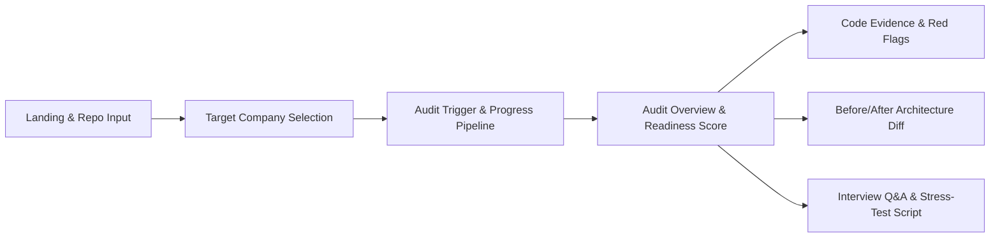

# Product & UI/UX Design System Specification

## 1. Product Vision & Design Philosophy

**ProjectGlowUp AI (StackFit AI)** is an engineering intelligence and codebase audit dashboard. It is designed to look and feel like a modern developer observability tool (such as Sentry, Datadog, or GitHub Code Scanning), rather than a generic conversational AI chatbot.

### Core Visual Principles
- **Engineering Rigor Over AI Gimmicks:** Dense, clean, and structured information layouts. No floating chatbot bubbles, conversational fillers, or purple pastel gradients.
- **Evidence-First UI:** Every recommendation is visually anchored to an inspected repository file citation with exact lines and observable source snippets.
- **Visual Proof Over Text Walls:** Architecture gaps are communicated via interactive, zoomable Mermaid.js Before/After diagrams.
- **Truth in Presentation:** High visual contrast separating **Verified Static Findings** (deterministic checks) from **AI Architectural Synthesis** (Gemini-generated improvements).

---

## 2. User Personas & Main Journeys

### Persona: Arjun (Pre-Final Year Engineering Student)
- **Background:** Built an e-commerce backend in Node.js and MongoDB from a YouTube tutorial. Has an on-campus placement drive with Razorpay in 5 days.
- **Goal:** Understand why his project gets ignored in resume rounds and identify the exact 2–3 production upgrades needed to impress fintech interviewers.
- **Pain Point:** Anxious about being grilled on database transactions and payment failures.

### Primary User Journey


1. **Submission (0–15s):** Enters public GitHub URL, selects "Razorpay", clicks "Analyze Repository".
2. **Analysis Progress (15–30s):** Visual multi-step progress bar showing file tree ingestion $\rightarrow$ static heuristics $\rightarrow$ architecture synthesis.
3. **Audit Dashboard Review (30–90s):**
   - Reviews overall readiness score and critical red flags.
   - Inspects the Before/After architecture diagram.
   - Copies the generated concurrency load-test script to run locally.
   - Studies the tailored interview defense questions.

---

## 3. Information Architecture & Route Structure

The application is structured as a streamlined, high-efficiency single-page dashboard with clean modal/slide-over views for detailed evidence inspections.

```
/ (Root Route)
├── Hero & Audit Input Section
│   ├── Repository URL Field (with quick sample repo buttons)
│   ├── Target Company Selector Grid (Razorpay, Swiggy, Zerodha, Amazon)
│   └── "Run Engineering Audit" Action Button
│
├── Live Audit Results (Conditional Render upon Completion)
│   ├── Audit Header (Repo Name, Stars, Commit SHA, Company Profile, Readiness Score)
│   ├── Metric Strip (Critical Red Flags, Architecture Gaps, Test Scripts Generated)
│   │
│   ├── Tab 1: Code Findings (Evidence-First Issue Feed)
│   │   ├── Severity Filters (All, Critical, Warning, Optimization)
│   │   └── Finding Cards (Title, File Path, Code Diff, Remediation)
│   │
│   ├── Tab 2: Architecture Diff (Interactive Mermaid.js Visualizer)
│   │   ├── Current Architecture (Toy/Tutorial Structure)
│   │   └── Target Architecture (Production-Grade Hardened Structure)
│   │
│   ├── Tab 3: Interview Defense & Load-Test Harness
│   │   ├── "What Interviewers Will Ask" Drill Cards
│   │   └── Syntax-Highlighted Runnable Test Script (.js / k6)
│   │
│   └── Export Actions (Copy Markdown Report, Share Link)
│
└── /evidence (Secondary Route)
    └── Public display of student interview evidence and survey methodology
```

---

## 4. Design System Tokens & Typography

The design system uses a dark-first developer theme inspired by terminal interfaces and high-density IDEs.

### Color Tokens (Tailwind CSS Mapping)

```css
:root {
  /* Surface & Background */
  --bg-primary: #090D16;       /* Deep slate-black canvas */
  --bg-secondary: #0F172A;     /* Card surface */
  --bg-tertiary: #1E293B;      /* Inset wells, code blocks, borders */
  --bg-elevated: #334155;      /* Popovers and modal overlays */

  /* Text & Content */
  --text-primary: #F8FAFC;     /* High contrast white-silver */
  --text-secondary: #94A3B8;   /* Muted captions and labels */
  --text-tertiary: #64748B;    /* Disabled states, subtle metadata */

  /* Brand & Accents */
  --accent-cyan: #06B6D4;      /* Primary action & telemetry */
  --accent-blue: #3B82F6;      /* Secondary links & focus rings */

  /* Severity Tokens */
  --severity-critical-bg: rgba(239, 68, 68, 0.12);
  --severity-critical-border: #EF4444;
  --severity-critical-text: #FCA5A5;

  --severity-warning-bg: rgba(245, 158, 11, 0.12);
  --severity-warning-border: #F59E0B;
  --severity-warning-text: #FCD34D;

  --severity-info-bg: rgba(59, 130, 246, 0.12);
  --severity-info-border: #3B82F6;
  --severity-info-text: #93C5FD;

  --severity-pass-bg: rgba(16, 185, 129, 0.12);
  --severity-pass-border: #10B981;
  --severity-pass-text: #6EE7B7;
}
```

### Typography Hierarchy
- **Font Family (UI):** `Inter`, system-ui, -apple-system, sans-serif
- **Font Family (Code & Diagrams):** `JetBrains Mono`, `Fira Code`, monospace
- **Scale:**
  - H1 / Dashboard Title: `28px` (`font-bold`, tracking tight)
  - H2 / Section Header: `20px` (`font-semibold`)
  - H3 / Card Title: `15px` (`font-semibold`)
  - Body Text: `14px` (`leading-relaxed`)
  - Micro / Labels: `12px` (`font-mono`, uppercase tracking wider)
  - Code Blocks: `13px` (`font-mono`)

---

## 5. Core Component Design & States

### 1. Repository Input & Company Selector
- **URL Input Field:** Clean terminal-style input with GitHub icon, inline validation (detects invalid URL formats immediately before submit), and clear button.
- **One-Click Sample Badges:** Quick buttons (`Try Razorpay Sample`, `Try Swiggy Sample`) allowing judges to audit a pre-configured repo with 1 click.
- **Target Company Cards:**
  - Crisp grid of selectable tiles:
    - **Razorpay** (Fintech, Idempotency, Ledgers)
    - **Swiggy** (Foodtech, Concurrency, Geo-Index)
    - **Zerodha** (Trading, Low-Latency, Minimalist)
    - **Amazon** (Cloud, Resilience, Distributed Scale)
  - Selected state: Subtle cyan border (`border-cyan-500`) with accent checkmark.

### 2. Loading & Progress State
Instead of a generic spinning wheel, the loading screen features a step-by-step terminal execution log:
- `[OK]` Fetched repository file tree (42 files discovered)
- `[OK]` Filtered 6 architectural files (`package.json`, `schema.prisma`, `routes`)
- `[BUSY]` Running static pattern heuristics...
- `[WAIT]` Synthesizing target-company engineering rubric...

### 3. Finding Card Anatomy (Evidence-First)
Every card displays:
1. **Header Badge:** Severity (`CRITICAL` | `WARNING` | `OPTIMIZATION`) + Category (`DATA INTEGRITY`, `CONCURRENCY`, `SECURITY`).
2. **Title:** Clear, concise problem statement (e.g., *Floating-point representation used for payment balances*).
3. **Evidence Box:** Syntax-highlighted code snippet with file path and line numbers (`prisma/schema.prisma:18`).
4. **Impact:** Explicit explanation of why the target company's engineering team will reject this pattern.
5. **Remediation:** Drop-in code solution with explanatory comments.

### 4. Interactive Architecture Diff Viewer
- Split-screen comparison view:
  - **Left Box:** "Current Observed Architecture" (Tutorial clone style).
  - **Right Box:** "Production Hardened Architecture" (Company-grade style).
- Rendered via **Mermaid.js** with zoom controls, reset view, and copy Mermaid source button.

### 5. Runnable Test Script Sandbox
- Dark-themed code container featuring syntax highlighting for Node.js / k6 scripts.
- **Sticky Actions:**
  - `Copy Script` button with instant copy feedback.
  - `Download .js` button.
- **Run Instructions:** Expandable terminal commands showing exact instructions:
  ```bash
  node stress-test.js http://localhost:3000/api/charge
  ```

---

## 6. Error, Empty, and Edge States

| State | Visual Treatment | Actionable Resolution |
|---|---|---|
| **Empty Repo** | Slate container with warning icon | Prompt user that repository contains no code files or supported manifests. |
| **Private / 404 Repo** | Error card with lock icon | Instruct user to ensure repository is public or verify URL spelling. |
| **GitHub Rate Limit** | Amber warning banner | Display exact time until rate limit reset and option to retry. |
| **Gemini Quota Lag** | Graceful degradation alert | Display static heuristic findings immediately while retrying semantic generation. |
| **Invalid URL** | Inline input error | Highlight input in red with text: *"Must be a valid public GitHub URL (e.g. https://github.com/owner/repo)"*. |

---

## 7. Accessibility & UI Consistency Standards

- **Color Contrast:** All text meets WCAG AA standards (minimum 4.5:1 contrast ratio against dark backgrounds).
- **Keyboard Navigation:** Full tab-order navigation across URL input, company selection cards, tabs, and action buttons.
- **Screen Reader Support:** ARIA labels on all icon-only buttons (copy, zoom, expand).
- **Responsive Layout:**
  - Desktop (>1024px): Two-column layout for architecture diff and findings.
  - Tablet (768px–1024px): Stacked single-column with tabbed architecture view.
  - Mobile (<768px): Fully responsive vertical flow; horizontal scroll for code snippets and Mermaid diagrams.
