# Product Requirements Document & Engineering Standards (PRD.md)

**Project:** ProjectGlowUp AI (StackFit AI)  
**Hackathon Track:** Problem Statement 4 — Open Innovation (Student Pain Points)  
**Document Status:** Authoritative Product & Engineering Specification  
**Version:** 1.0.0 (Foundation Phase)

---

## 1. Executive Summary & Problem Space

### 1.1. Problem Definition
College engineering students spend 100+ hours creating tutorial clones (e.g., MERN e-commerce, Netflix clones, basic weather apps). While syntactically valid, these projects lack the domain engineering patterns expected by top-tier tech firms (Razorpay, Swiggy, Zerodha, Amazon)—such as transaction atomicity, idempotency, concurrency control, caching strategies, rate limiting, and structured observability.

Consequently:
- Resumes are filtered out during technical screenings.
- Candidates freeze during technical interview cross-examinations on architectural trade-offs and scale.
- Existing resume ATS tools only match keywords without inspecting code, and generic AI assistants generate abstract text walls without analyzing actual repositories.

### 1.2. The Solution
**ProjectGlowUp AI** is a web-based engineering intelligence platform that audits a student's public GitHub repository against the specific engineering expectations of their chosen target company. It delivers:
1. Grounded code-level red flags with direct file citations.
2. An interactive Before/After architecture comparison in Mermaid.js.
3. Runnable edge-case concurrency/load-test scripts for students to run locally.
4. Targeted interview defense question-and-answer talking points.

---

## 2. User Personas & Target Audience

### 2.1. Primary Persona: The Placements Aspirant (Tier 2/3 College Senior)
- **Profile:** 3rd or 4th-year Computer Science / Engineering student preparing for on-campus placement drives or off-campus applications.
- **Current State:** Has 2–3 portfolio projects built by following YouTube tutorials; does not know what tech panels look for beyond "clean UI".
- **Pain Point:** Struggles to explain system design decisions during interviews; fears being exposed as having copied tutorial code.
- **Success Criteria:** Walks into technical rounds equipped with concrete talking points, benchmark test numbers, and production-grade patterns.

### 2.2. Secondary Persona: Hackathon & Recruiter Judges
- **Profile:** Senior software engineers, engineering managers, and technical evaluators.
- **Evaluation Need:** Rapidly assess code depth, evidence grounding, architectural rigor, and usability in a 3-minute live demonstration.

---

## 3. Functional Requirements (FR)

| ID | Requirement | Description |
|---|---|---|
| **FR-01** | **Repository Ingestion** | Accept a valid public GitHub URL (`https://github.com/owner/repo`). Fetch the file tree via GitHub REST API v3 in a single recursive tree call; filter and download up to 10 prioritized architectural files (max 50 KB each). |
| **FR-02** | **Target-Company Rubric Selection** | Enable user selection of target tech company profile (Razorpay/Fintech, Swiggy/Logistics, Zerodha/Low-Latency, Amazon/Cloud). |
| **FR-03** | **Deterministic Static Audit** | Scan manifests (`package.json`) and schemas (`schema.prisma`, SQL models) for immediate anti-patterns (floating-point currency, missing indexes, unhandled rejections). |
| **FR-04** | **Semantic AI Audit** | Submit sanitized code context to Google Gemini Flash using strict JSON `responseSchema` to evaluate domain architectural alignment. |
| **FR-05** | **Evidence-Anchored Findings** | Display findings categorized by severity (`Critical`, `Warning`, `Optimization`) with exact file paths and line citations. |
| **FR-06** | **Mermaid Architecture Diff** | Render client-side interactive Mermaid.js diagrams comparing Current (Toy) vs. Target (Hardened Production) system architectures. |
| **FR-07** | **Runnable Concurrency Test Harness** | Generate a standalone 20–30 line Node.js / k6 test script simulating domain edge cases (e.g. race-condition balance debits, duplicate webhook deliveries). |
| **FR-08** | **Interview Defense Q&A** | Provide 3–5 company-specific technical interview questions directly probing the identified architectural changes with model answer talking points. |

---

## 4. Non-Functional Requirements (NFR)

| ID | Category | Requirement |
|---|---|---|
| **NFR-01** | **Performance** | End-to-end audit processing must complete in <4 seconds under typical network conditions. |
| **NFR-02** | **Cost & Quotas** | Zero paid infrastructure. Must operate 100% within Google AI Studio free tier (15 RPM, 1,500 RPD) and Vercel free hosting. |
| **NFR-03** | **Security (No Code Exec)** | The server must never execute, compile, or evaluate user repository code or generated test scripts. |
| **NFR-04** | **SSRF Mitigation** | Strict regex restricts outbound network calls exclusively to `https://api.github.com` and Google AI Studio endpoints. |
| **NFR-05** | **Prompt Injection Resilience** | User repository code must be enclosed in structural XML delimiters (`<untrusted_source_code>`) with explicit system instructions to ignore embedded commands. |
| **NFR-06** | **Reliability & Fallback** | In the event of Gemini quota limits or network delays, the application must display static heuristic findings immediately rather than showing a blank screen. |
| **NFR-07** | **Accessibility & UX** | WCAG AA compliance (contrast ratio $\ge$ 4.5:1), responsive layout for desktop and mobile, keyboard navigation support. |

---

## 5. Engineering Standards & Developer Playbook

### 5.1. Priority Hierarchy
When resolving engineering trade-offs, follow this strict priority:
1. **Correctness:** Ground findings in observable repository facts; never hallucinate line numbers or files.
2. **Security:** Zero SSRF, zero prompt execution, zero credential exposure.
3. **Reliability:** Graceful handling of network timeouts, rate limits, and 404s.
4. **Evidence Quality:** Real student research in `evidence/` and concrete code citations.
5. **User Experience:** Clean developer-tool UI, responsive, accessible.
6. **Performance:** Under 3 seconds end-to-end response time.
7. **Maintainability:** Minimal abstractions, strict YAGNI (Ponytail philosophy).

### 5.2. Definition of Done (DoD)
A feature is complete only when:
- Written in strict TypeScript (`strict: true`, zero `any`).
- Input validated at all network boundaries using Zod or equivalent guards.
- All external API calls have explicit timeouts and catch blocks.
- Zero server secrets leaked in client bundles or public responses.
- Edge cases (empty repos, rate limits, private repos) tested and handled.
- UI tested on desktop and mobile viewports.
- Documentation (`MEMORY.md`, `README.md`) updated.

### 5.3. Code Conventions
- **TypeScript:** Strict type safety, explicit interfaces, no `any`, favor native Web Platform APIs (`fetch`, `URL`, `crypto`).
- **Next.js & React:** React Server Components by default; `'use client'` only for interactive state, local storage, or Mermaid rendering.
- **State Management:** Keep state local with `useState` and URL search parameters; avoid external state libraries (Redux, Zustand) for MVP.
- **API Standard Error Envelope:**
  ```json
  {
    "error": {
      "code": "RATE_LIMIT_EXCEEDED",
      "message": "GitHub API rate limit reached. Retry in 10 minutes.",
      "retryAfterSeconds": 600
    }
  }
  ```

---

## 6. Hackathon Deliverables & Milestone Roadmap

```mermaid
gantt
    title ProjectGlowUp AI Hackathon Roadmap
    dateFormat  HH
    axisFormat  %H:00
    section Foundation
    Architecture & PRD Specs       :done, 00, 02h
    section Core Build
    GitHub Tree & File Ingestor    :active, 02, 05h
    Static Heuristic Scanner Engine: 05, 08h
    Gemini Structured JSON API     : 08, 11h
    section Frontend & UI
    Dashboard UI & Mermaid Viewer  : 11, 14h
    section Validation & Deploy
    Student Evidence Vault Notes   : 14, 15h
    Vercel Deployment & Smoke Tests: 15, 16h
```


