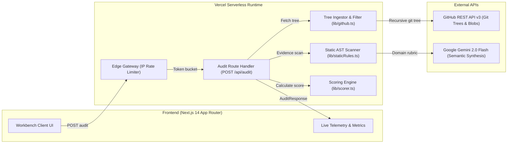

# ProjectGlowUp AI (StackFit AI)

> **Hackathon Track:** Problem Statement 4 — Open Innovation (Student Pain Points)  
> **One-Line Problem:** College students build generic tutorial projects that lack target-company engineering patterns, causing instant resume rejections and technical interview failures.

---

## What It Does (Problem Statement 4)

**ProjectGlowUp AI** is an engineering intelligence web application that audits a student’s actual public GitHub repository against the production-grade engineering standards of their target company (such as Razorpay, Swiggy, Zerodha, or Amazon). Instead of scanning resume keywords like an ATS or generating generic advice like a standard chatbot, it inspects real repository code, detects architectural anti-patterns, generates interactive Before/After system design diagrams in Mermaid.js, and provides runnable concurrency/load-test scripts to help students defend their code in technical interviews.

---

## Hackathon Progress Status (Done / Left / Plan)

### What Works Now (Done)
- [x] Complete system architecture specification and data-flow model (`ARCHITECTURE.md`).
- [x] Architecture Decision Records log covering 10 foundational decisions (`DECISIONS.md`).
- [x] High-density engineering UI/UX design system and token definitions (`DESIGN.md`).
- [x] AI agent operational boundaries and security invariants (`RULES.md`, `PRD.md`).
- [x] Comprehensive testing strategy and edge-case failure matrix (`TESTING.md`).
- [x] Primary student research methodology and evidence vault structure (`evidence/README.md`).
- [x] 5 authentic student interviews (`evidence/interviews/student-01.md` - `05.md`) & quantitative survey (`evidence/survey/responses.md`).
- [x] Next.js 14+ (App Router), TypeScript, Tailwind CSS, Lucide React, and Mermaid.js setup.
- [x] GitHub REST API tree fetcher with 50 KB file boundaries & campus CDN probe fallback (`lib/github.ts`).
- [x] Static rule engine detecting float currency, missing idempotency, unindexed coordinates, missing FK indexes, and secrets (`lib/staticRules.ts`).
- [x] Structured JSON audit synthesis with Google Gemini Flash API (`lib/gemini.ts`).
- [x] Client-side Before/After Mermaid.js system diff visualizer (`components/MermaidViewer.tsx`).
- [x] Custom company profile creation, editing, deletion, and local storage persistence (`components/AuditForm.tsx`).
- [x] Target role selection (SDE Intern, Backend, Frontend, Full-Stack, DevOps, QA Automation) and custom role creation (`lib/roles.ts`).
- [x] Transparent explainable scoring engine with severity deductions and coverage factor (`lib/scorer.ts`).
- [x] Exact file citation line numbers, source excerpts, and architectural reasoning in findings (`lib/staticRules.ts`).
- [x] Dynamic, repository-grounded concurrency stress test harnesses targeting discovered routes (`lib/gemini.ts`).
- [x] Cross-audit state isolation preventing stale findings leakage between consecutive audits (`app/page.tsx`).
- [x] Runnable concurrency test harness sandbox with 1-click clipboard copy (`components/TestScriptSandbox.tsx`).
- [x] Technical interview defense drill generator calibrated to company & target role (`components/InterviewDefense.tsx`).
- [x] Simulated pipeline terminal indicator (`components/ProgressTerminal.tsx`).
- [x] 1-click live demo presets across all 4 target companies (`components/AuditForm.tsx`).
- [x] In-memory sliding-window IP rate limiter (`lib/rateLimiter.ts`).
- [x] SSRF, URL validation, and untrusted code delimiter boundaries.
- [x] End-to-end automated unit test suite passing 29/29 tests (`scripts/run-tests.ts`).

### Ready for Demo & Deployment
- [x] Verified zero TypeScript compilation errors (`npm run type-check`).
- [x] Verified zero Next.js production build errors (`npm run build`).
- [x] Continuous GitHub tracking at `https://github.com/calligraphyguruji/project-glowup.git`.

---

## Problem & Motivation

Engineering students spend hundreds of hours following online tutorials to build boilerplate projects (e.g., MERN e-commerce clones, Netflix clones, weather apps). When they apply to top tech firms, these projects are rejected because:
1. **Zero Domain Engineering:** A fintech company (e.g., Razorpay) requires transaction atomicity, ledger consistency, and idempotent request handling; a generic MERN app uses unprotected floating-point arithmetic and direct MongoDB writes.
2. **Failure Under Interview Cross-Examination:** When interviewers ask *"How does your app handle 500 concurrent balance deductions?"*, candidates freeze because they never considered concurrency.
3. **Existing Tool Gaps:**
   - **ATS Scanners:** Only count keywords in PDFs without ever inspecting code.
   - **Generic AI Chatbots:** Output walls of abstract text and tutorial suggestions without analyzing the student's actual repository files.

---

## System Architecture (Generated with Archify)

ProjectGlowUp AI is built as a serverless pipeline with zero runtime database dependencies, designed for low latency, reproducible evaluations, and defensive execution bounds.

An interactive, showcase-grade architecture viewer with inline SVG and dark/light modes is rendered at [`public/architecture.html`](file:///Users/calligraphyguruji/Azisly%20Hackathon/public/architecture.html).



### Architectural Subsystems
1. **Edge Gateway & SSRF Boundary:** Validates public GitHub URLs against strict regex allowlists and enforces sliding-window IP rate limiting.
2. **Bounded Tree Ingestor:** Discovers repository git trees recursively, filters non-code assets and documentation, and prioritizes schemas, models, and server entrypoints up to a 50 KB per-file budget.
3. **Deterministic AST Scanner:** Inspects code syntax for IEEE-754 float currency representation, missing idempotency headers, unindexed geospatial queries, and hardcoded credentials with exact 1-indexed line numbers.
4. **Google Gemini Flash Synthesizer:** Grounds architectural Before/After Mermaid diagrams and concurrency test scripts in observed routes and candidate tech stack.
5. **Explainable Scoring Engine:** Computes transparent grades (A–F) through calibrated severity deductions (-18 critical, -7 warning) and coverage factors.

---

## Proposed Solution & Core Features

```mermaid
flowchart LR
    A[Student GitHub Repo URL + Target Company] --> B[GitHub REST API Ingestor]
    B --> C[Static Heuristic Scanner]
    C --> D[Gemini Flash Semantic Engine]
    D --> E[Interactive Audit Report]
    E --> F[Code Red Flags with File Citations]
    E --> G[Before/After Architecture Diff (Mermaid)]
    E --> H[Runnable Concurrency Test Script]
    E --> I[Interview Defense Q&A Sheet]
```

### Key Differentiators
- **Real Code Inspection:** Reads actual schemas (`schema.prisma`), server files, and `package.json` directly from GitHub.
- **Before/After Visual Architecture Diff:** Visualizes missing production layers (e.g., Redis idempotency guards, task queues) using interactive Mermaid.js flowcharts.
- **Runnable Edge-Case Test Harness:** Provides copyable Node.js / k6 scripts so students can benchmark and prove their project's resilience.
- **Interview Defense Drill:** Generates the exact technical questions interviewers will ask about these specific code trade-offs.

---

## Technology Stack

- **Frontend:** Next.js (App Router), TypeScript, Tailwind CSS, Mermaid.js
- **Backend:** Next.js Route Handlers (Node.js runtime)
- **AI Engine:** Google Gemini Flash (2.0 / 1.5) via Google AI Studio (`@google/genai`)
- **Code Ingestion:** GitHub REST API v3
- **Deployment:** Vercel (100% Free Tier)
- **Testing:** Vitest (Planned)

---

## Illustrative Audit Workflow

*(Example based on testing an unhardened Node.js/PostgreSQL expense tracker against Razorpay standards)*

1. **Input:** Student submits `https://github.com/student/expense-tracker` and selects **Razorpay (Fintech)**.
2. **Observed Evidence:** The parser inspects `prisma/schema.prisma` and detects `amount Float` on line 14.
3. **Critical Finding:** Flags floating-point currency representation as an immediate rejection risk; provides drop-in remediation converting to `amount Int` (stored in paise).
4. **Architecture Upgrade:** Renders Before/After Mermaid diagram adding an Idempotency-Key cache layer and webhook retry queue.
5. **Interview Test Script:** Generates a 20-line test script firing 10 concurrent HTTP requests with the identical transaction key to demonstrate race-condition safety.

---

## Security & Privacy Principles

- **Zero Remote Code Execution:** The server **never** executes, compiles, or runs submitted repository code or generated test scripts.
- **SSRF Mitigation:** Strict URL regex restricts all outbound requests exclusively to `https://api.github.com`.
- **Secret Isolation:** API keys (`GEMINI_API_KEY`, `GITHUB_TOKEN`) are server-only and never leaked to the client browser.
- **Stateless Operation:** No student code or personal data is permanently stored in a database.

---

## Environment Variables

| Variable Name | Purpose | Required | Example / Default |
|---|---|---|---|
| `GEMINI_API_KEY` | Authenticates requests to Google AI Studio | **Yes** | `AIzaSy...` (Get free at [aistudio.google.com](https://aistudio.google.com/)) |
| `GEMINI_MODEL` | Specifies the Gemini model identifier | No | `gemini-2.0-flash` |
| `GITHUB_TOKEN` | Raises GitHub rate limit from 60 to 5,000 req/hr | No | `ghp_...` (Read-only personal token) |
| `NEXT_PUBLIC_APP_URL` | Base application URL for origin verification | No | `http://localhost:3000` |
| `NODE_ENV` | Runtime environment mode | No | `development` |

---

## Local Setup & Development Commands

### Prerequisites
- Node.js 18.17+ or 20+
- npm, pnpm, or yarn

### Installation
```bash
# 1. Clone repository
git clone https://github.com/your-username/project-glowup-ai.git
cd project-glowup-ai

# 2. Copy environment template
cp .env.example .env.local

# 3. Add your free Gemini API key to .env.local
# GEMINI_API_KEY=your_actual_key_here

# 4. Install dependencies (once package.json is initialized)
npm install

# 5. Start local development server
npm run dev
```

Visit `http://localhost:3000` to interact with the dashboard.

---

## Student Problem Evidence (`evidence/` Directory)

In accordance with Problem Statement 4 guidelines, all claims of student need are supported by primary research stored in the [`evidence/`](file:///Users/calligraphyguruji/Azisly%20Hackathon/evidence/README.md) folder:
- **`evidence/interviews/`:** Anonymized notes from 5 engineering students on project rejection experiences.
- **`evidence/survey/`:** Survey methodology and quantitative data on tutorial-clone prevalence.
- **`evidence/references/`:** Public engineering blog citations (Razorpay, Swiggy, Zerodha).

---

## Proposed License

Proposed under the **MIT License**.
